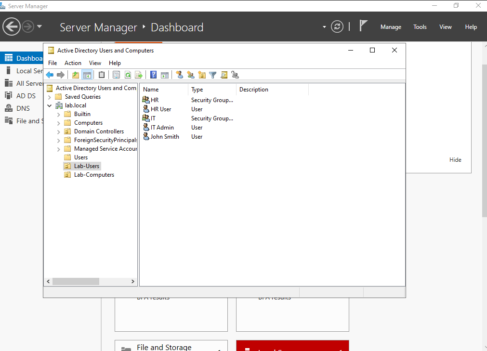
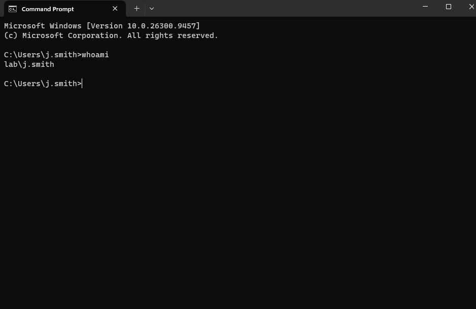

# 01 · Lab build: Active Directory domain

**Goal:** build a small Windows domain to practise on: a domain controller, a domain-joined client, and users with different privilege levels.

**Result:** `lab.local` domain on Windows Server 2022, a Windows 11 Enterprise client joined to it, and OUs, users and groups created with a PowerShell script.

## Build steps

### 1. Domain controller (DC01)
- Windows Server 2022 Standard Evaluation (Desktop Experience), 4 GB RAM, 2 vCPU, 50 GB disk, on a VirtualBox NAT network (`LabNet`, 10.0.2.0/24).
- Static IP `10.0.2.10/24`, gateway `10.0.2.1`, DNS `127.0.0.1`.
- Installed Active Directory Domain Services and promoted the server to a new forest, `lab.local`.
- Set the time zone to UK time, so log timestamps line up with the analysis: `tzutil /s "GMT Standard Time"`.
- Added DNS forwarders so the domain can resolve internet names for updates:
  ```powershell
  Add-DnsServerForwarder -IPAddress 1.1.1.1,8.8.8.8
  ```

### 2. Users, groups and OUs
Created with [`scripts/create-lab-users.ps1`](scripts/create-lab-users.ps1):

| Account | Type | Groups |
| --- | --- | --- |
| `j.smith` | Standard user | — |
| `hr.user` | Standard user | HR |
| `it.admin` | Administrator | IT, Domain Admins |

Only one account has administrative rights, so least privilege applies from the start.

### 3. Client (CLIENT01)
- Windows 11 Enterprise Evaluation, 4 GB RAM, 2 vCPU, 64 GB disk, on `LabNet`.
- DNS pointed at the domain controller (`10.0.2.10`), then joined to the domain:
  ```powershell
  nslookup lab.local
  Add-Computer -DomainName lab.local -NewName CLIENT01 -Credential lab\it.admin -Restart
  ```
- Moved into its OU from DC01:
  ```powershell
  Get-ADComputer CLIENT01 | Move-ADObject -TargetPath "OU=Lab-Computers,DC=lab,DC=local"
  ```
- Verified by signing in as `lab\j.smith` and running `whoami`.

### 4. Scanning network
A second, host-only adapter (192.168.56.0/24) on each VM lets the host laptop scan them without touching the domain network. DC01's second adapter is kept out of DNS so clients don't try to reach the domain controller on the wrong address:
```powershell
Set-DnsClient -InterfaceAlias "Ethernet 2" -RegisterThisConnectionsAddress $false
```

## Troubleshooting

| Problem | Diagnosis | Fix |
| --- | --- | --- |
| Client said "your domain isn't available" | `nltest /dsgetdc:lab.local` showed it couldn't find the domain controller | Boot DC01 first and wait until it's fully up before starting the client |
| PowerShell commands "not recognised" | They were typed into Command Prompt | Type `powershell` first |
| Standard user couldn't elevate | UAC asks for an account that is an administrator on that machine | Elevate with a Domain Admins account |

## Evidence



