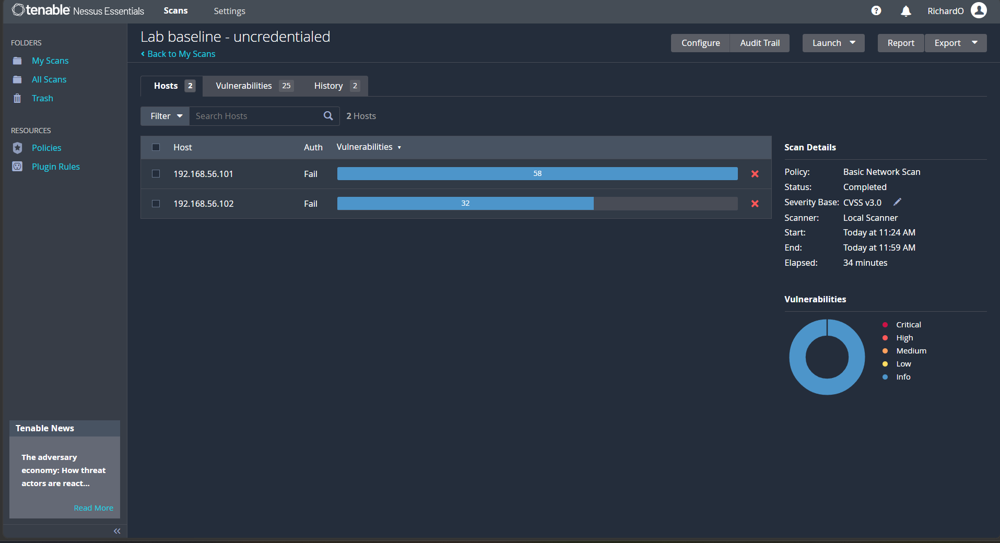
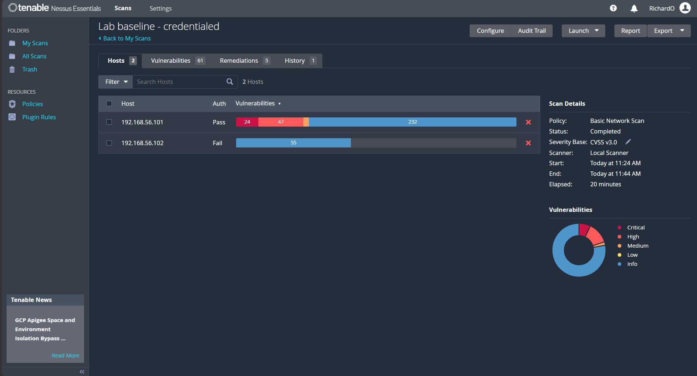
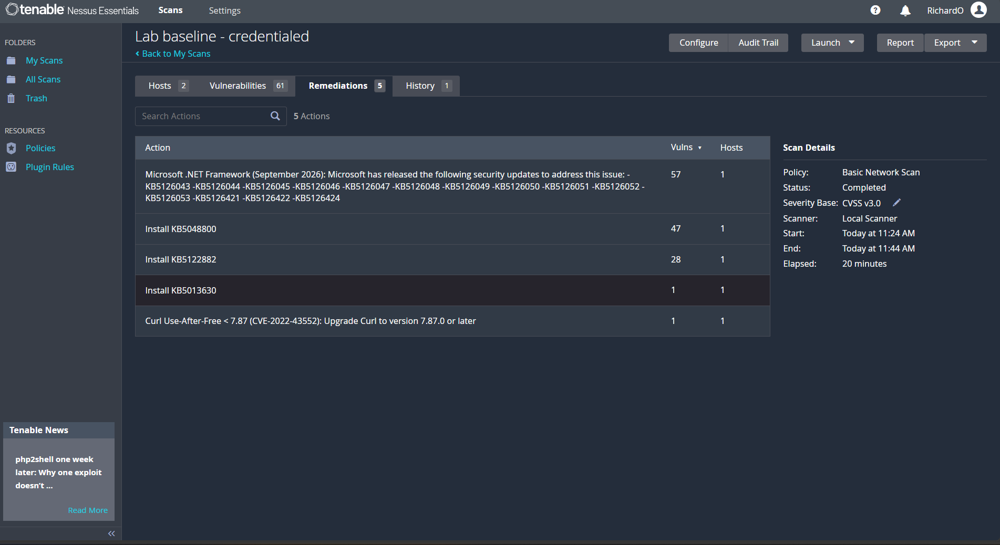
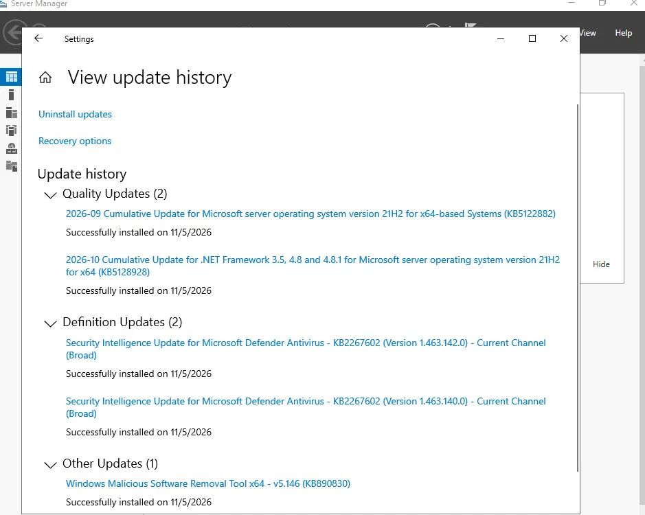
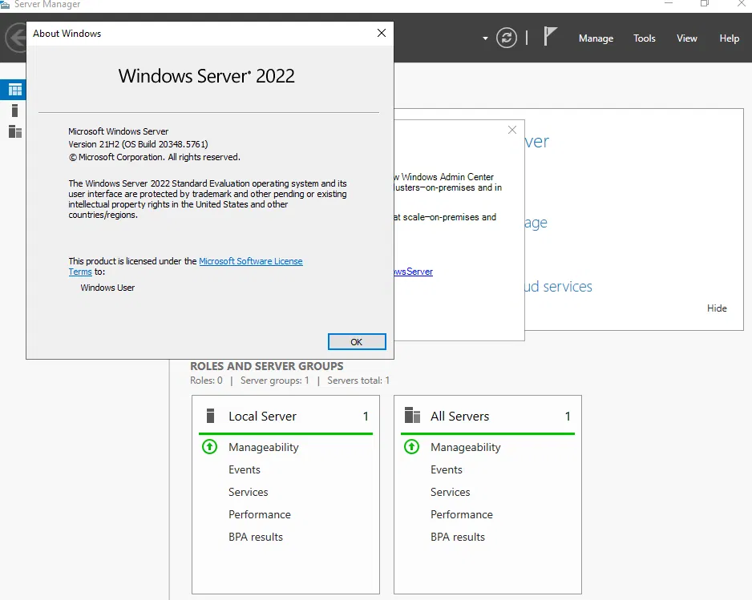
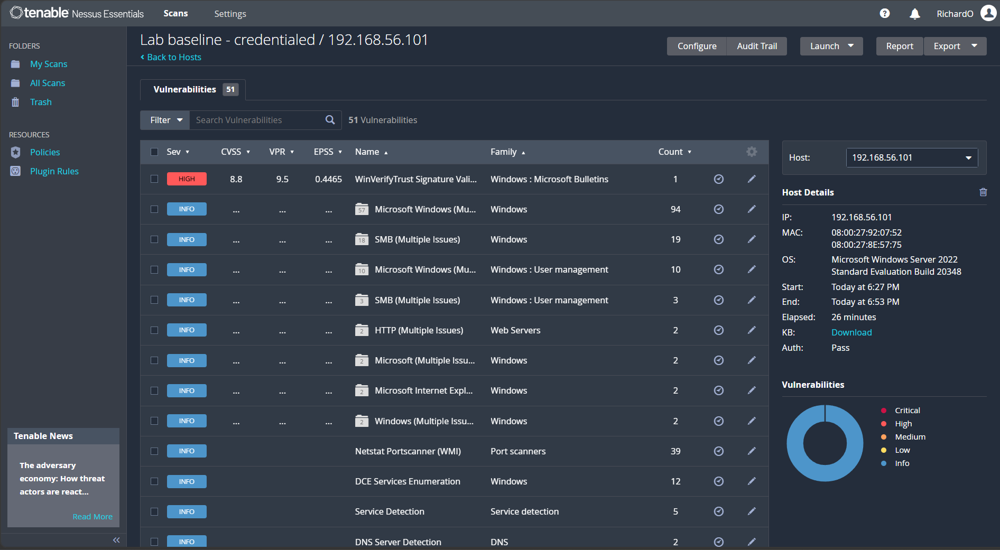
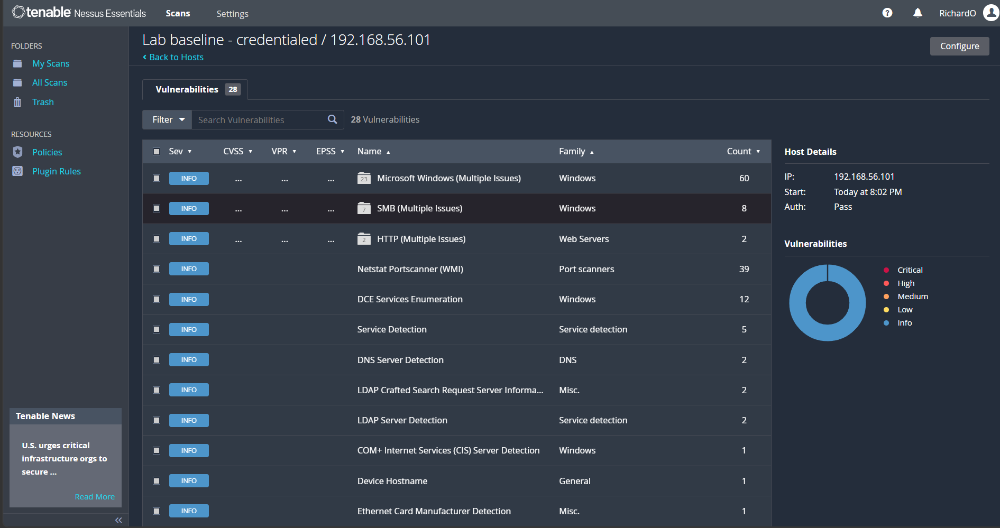

# 02 · Vulnerability management with Nessus

**Goal:** run the full vulnerability management cycle: scan, assess severity, prioritise, remediate, verify.

**Result:** the authenticated scan found **24 critical and 47 high** findings on the domain controller. Patching brought that down to **0 critical and 1 high**. The last one, CVE-2013-3900, needed a configuration change rather than a patch. After that change, the final scan showed **0 critical, 0 high**.

## Setup
- **Scanner:** Nessus Essentials on the host laptop. **Targets:** DC01 (192.168.56.101) and CLIENT01 (192.168.56.102). Scope is the lab only.
- **Firewall rules** on both VMs to allow scanning:
  ```powershell
  New-NetFirewallRule -DisplayName "Allow ICMPv4 - Lab Scan" -Protocol ICMPv4 -IcmpType 8 -Action Allow
  Enable-NetFirewallRule -DisplayGroup "File and Printer Sharing"
  ```
- **Scan 1:** Basic Network Scan, uncredentialed.
- **Scan 2:** the same policy, credentialed (Windows, `lab.local\it.admin`), with Remote Registry and administrative shares enabled during the scan.

## Uncredentialed vs credentialed

| Scan | DC01 | CLIENT01 |
| --- | --- | --- |
| Uncredentialed | Informational only | Informational only |
| Credentialed (before patching) | Auth pass: **24 critical, 47 high** | Credentials accepted over SMB, but local checks failed |

From the network, the domain controller looked clean. Logging in showed it was years behind on security updates (build **20348.587**). An uncredentialed scan shows the attack surface; a credentialed scan shows the patch gaps.

## Prioritised by remediation
Nessus grouped the findings by the fix that resolves them:

| Remediation | Findings resolved |
| --- | --- |
| .NET Framework security updates | 57 |
| Install KB5048800 | 47 |
| Install KB5122882 | 28 |
| Install KB5013630 | 1 |
| Upgrade curl to 7.87.0 or later (CVE-2022-43552) | 1 |

A handful of updates removes almost all the risk, so patching comes first and individual findings second.

## Findings written up

**1. Missing Windows Server cumulative updates (Critical)**
- *What it means:* the server is missing years of security fixes, including remotely exploitable flaws.
- *Risk:* on a domain controller, compromise means control of every account in the domain.
- *Fix:* Windows Update, installing the latest cumulative update.
- *Status:* fixed, verified by re-scan.

**2. Microsoft .NET Framework security updates (Critical/High)**
- *What it means:* the framework many Windows applications run on had unpatched vulnerabilities.
- *Fix:* the .NET cumulative update KB5128928.
- *Status:* fixed, verified by re-scan.

**3. curl use-after-free, CVE-2022-43552**
- *What it means:* a third-party tool shipped inside Windows was out of date. Vulnerabilities also live in bundled components, not just the operating system.
- *Fix:* updated through the cumulative update.
- *Status:* fixed, verified by re-scan.

## Remediation
- Installed through Windows Update: **KB5122882** (2026-09 cumulative update), **KB5128928** (.NET Framework, 2026-10), Defender security intelligence, and the Malicious Software Removal Tool.
- The build went from **20348.587 to 20348.5761**.

## Verification
The credentialed re-scan of DC01 showed **0 critical, 1 high**, with no medium or low findings left.

The remaining high is **WinVerifyTrust signature validation, CVE-2013-3900** (CVSS 8.8, VPR 9.5, EPSS 0.4465). Microsoft made this fix **opt-in**, so it isn't applied by any update. It needs the `EnableCertPaddingCheck` registry value set:
```powershell
$paths = 'HKLM:\Software\Microsoft\Cryptography\Wintrust\Config','HKLM:\Software\Wow6432Node\Microsoft\Cryptography\Wintrust\Config'
foreach ($p in $paths) { New-Item -Path $p -Force | Out-Null; New-ItemProperty -Path $p -Name EnableCertPaddingCheck -Value "1" -PropertyType String -Force | Out-Null }
```
In a real organisation this would be tested first, because the stricter signature check can break some older signed installers.

*Status:* fixed. After setting the registry value and restarting DC01, the credentialed re-scan on 12 Nov 2026 returned **0 critical, 0 high**, with only informational findings left.

**Lesson:** a fully updated system is not the same as a secure one.

## Open issue
The credentialed scan of CLIENT01 still reports "Auth: Fail". Plugin 141118 shows the `lab.local\it.admin` login was accepted over SMB, which points to an access problem on the host rather than wrong credentials.

## Evidence








