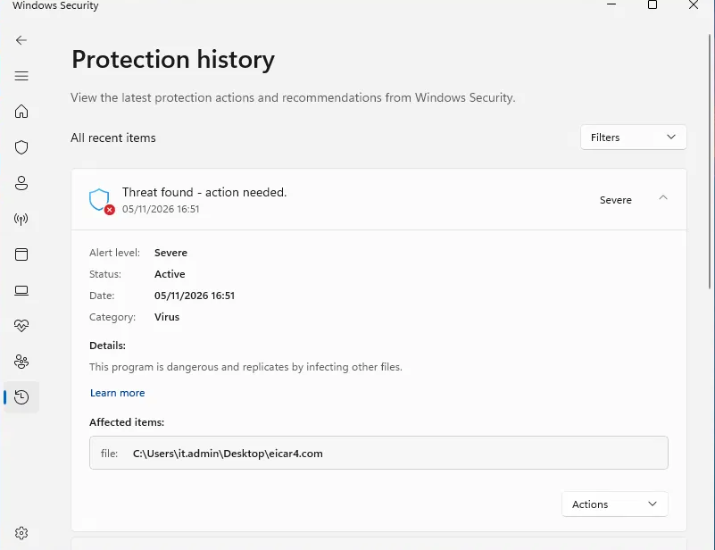
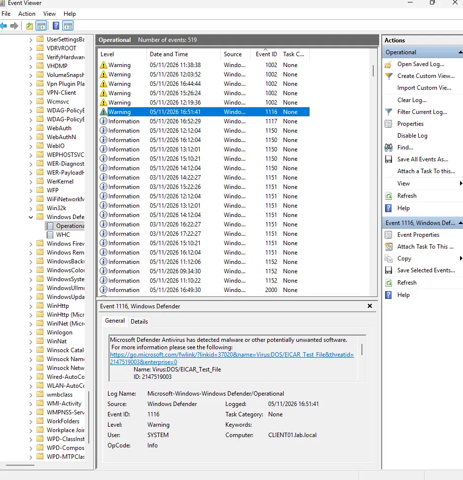
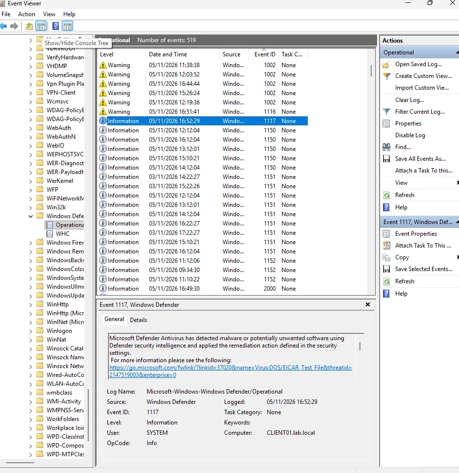

# 03 · Malware detection and triage (EICAR)

**Goal:** trigger a real Microsoft Defender detection safely, then investigate it the way a SOC analyst would: what was detected, where, by what process, what action was taken, and whether to escalate.

**Result:** Defender's real-time protection detected the test file and quarantined it 48 seconds later. The investigation flagged that the file had been written by PowerShell.

## Method
- Created the industry-standard [EICAR test file](https://www.eicar.org/download-anti-malware-testfile/) on CLIENT01. It is a harmless string every antivirus product is designed to detect.
- The string isn't included in this repo, so cloning it won't set off antivirus.

## Evidence collected

| Source | What it showed |
| --- | --- |
| Windows Security, Protection history | Severity: Severe · Category: Virus · File: `C:\Users\it.admin\Desktop\eicar4.com` |
| Event ID **1116** (threat detected) | `Virus:DOS/EICAR_Test_File`, threat ID 2147519003, at 16:51:41 on CLIENT01.lab.local |
| Event ID **1117** (action taken) | Remediation applied at 16:52:29 |
| `Get-MpThreatDetection` | Detection source: real-time protection · Process: `powershell.exe` · User: `LAB\it.admin` · Action: quarantined, successful |

Event log path: *Applications and Services Logs → Microsoft → Windows → Windows Defender → Operational*.

## Triage note

```
Alert:      Microsoft Defender — Virus:DOS/EICAR_Test_File, severity Severe
Host/User:  CLIENT01 / LAB\it.admin
File:       C:\Users\it.admin\Desktop\eicar4.com
Written by: powershell.exe
Detected:   16:51:41 by real-time protection (Event ID 1116)
Action:     Quarantined automatically at 16:52:29 (Event ID 1117), successful
Verdict:    Benign — controlled EICAR test, no further action
Escalate?:  In a real incident, yes. A file dropped by PowerShell is a common
            malware delivery pattern (MITRE ATT&CK T1059.001). Next checks:
            what launched PowerShell, whether the file exists on other hosts,
            and the user's recent activity.
```

## Troubleshooting
The first attempts didn't trigger Defender. Instead of assuming the tool was broken, I checked the file against the known EICAR values. It was 67 bytes instead of 68, and its SHA-256 hash didn't match, so the input was one character short. With the corrected file, Defender detected it immediately.

**Lesson:** when a detection doesn't fire, check the evidence before blaming the tool.

## Evidence




