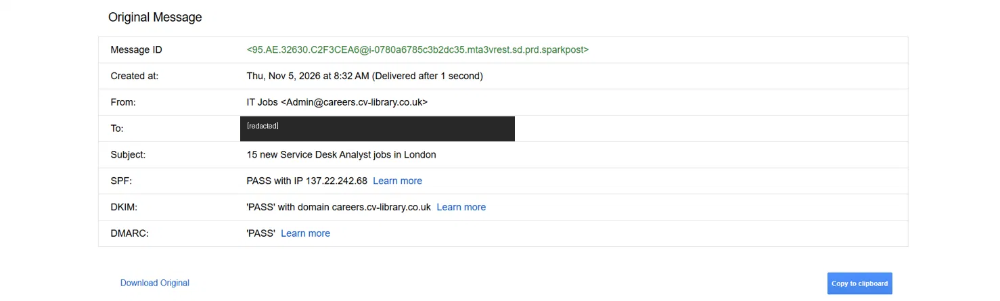

# 04 · Email header analysis

**Goal:** decide whether an email is phishing from its headers and links rather than its appearance. That's the first-line triage a SOC does on reported emails.

**Result:** the email was legitimate, so it was a false positive. The analysis also found that the sender's domain doesn't enforce DMARC.

## The email
- **Subject:** "15 new Service Desk Analyst jobs in London"
- **Display name and sender:** IT Jobs `<Admin@careers.cv-library.co.uk>`
- **Recipient:** [redacted]

## Checks

| Check | Finding | Assessment |
| --- | --- | --- |
| From vs Reply-To | `careers.cv-library.co.uk` vs `cv-library.co.uk` | Same organisation |
| Return-Path | Bounce address on `careers.cv-library.co.uk` | Aligned with the sender |
| SPF | Pass, sending IP 137.22.242.68 | Authorised sender |
| DKIM | Pass, signed by `careers.cv-library.co.uk` | Message not altered in transit |
| DMARC | Pass, but policy `p=none` | Passes, but the domain doesn't enforce DMARC |
| Links | `clicks.cv-library.co.uk` (click tracking), `cdn.braze.eu` (marketing images) | Expected for a marketing platform; no credential or payment request |
| Context | Subscribed to CV-Library job alerts | Expected sender and content |

## Verdict
Legitimate marketing email. False positive, no action needed.

## Analyst note
DMARC `p=none` means the domain only monitors failures. It doesn't tell receiving servers to reject mail that fails. Someone spoofing this sender could still get an email delivered, so passing SPF, DKIM and DMARC on this message doesn't prove every email using the CV-Library name is safe. Phishing (MITRE ATT&CK T1566) relies on exactly this kind of gap.

## Method
Gmail → ⋮ → **Show original** for the authentication summary and raw headers. Links were taken from the raw source rather than clicked. Any suspicious URL is defanged in notes, for example `hxxps://example[.]com`.

## Evidence

