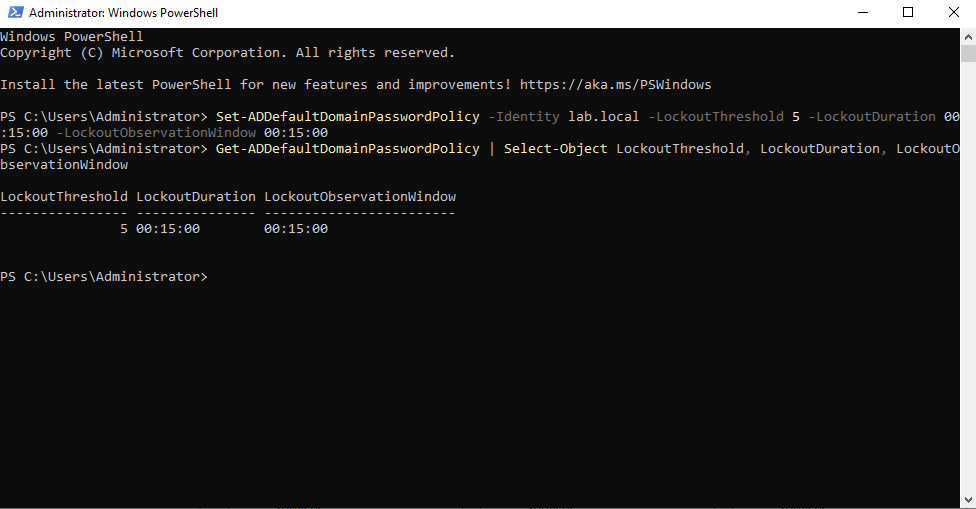
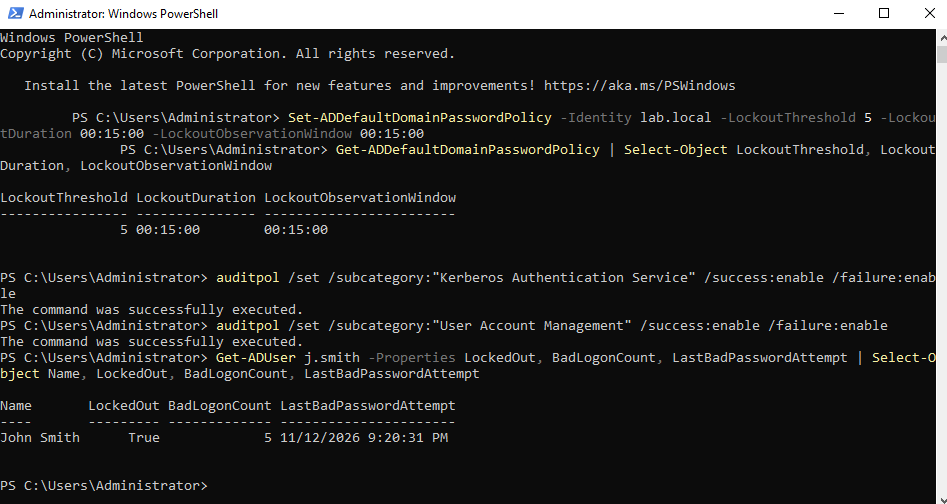
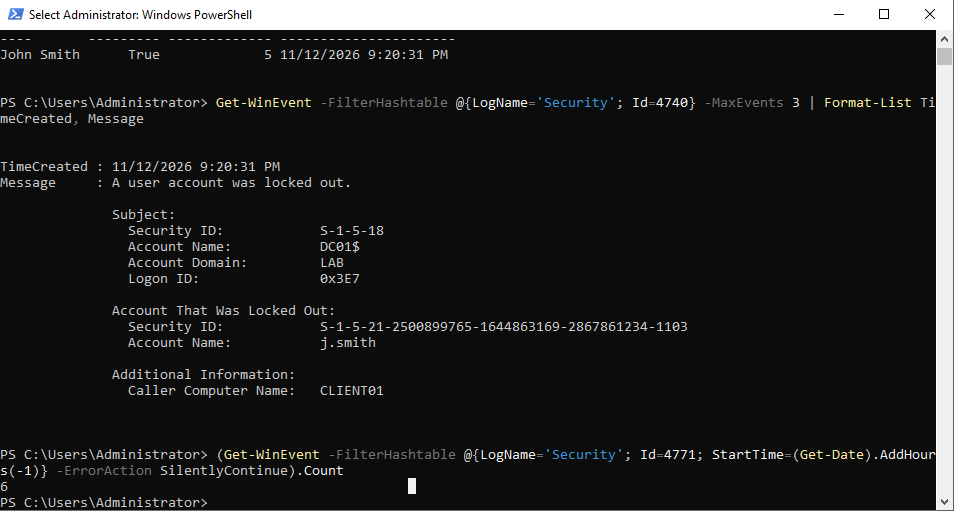
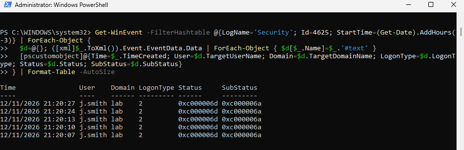
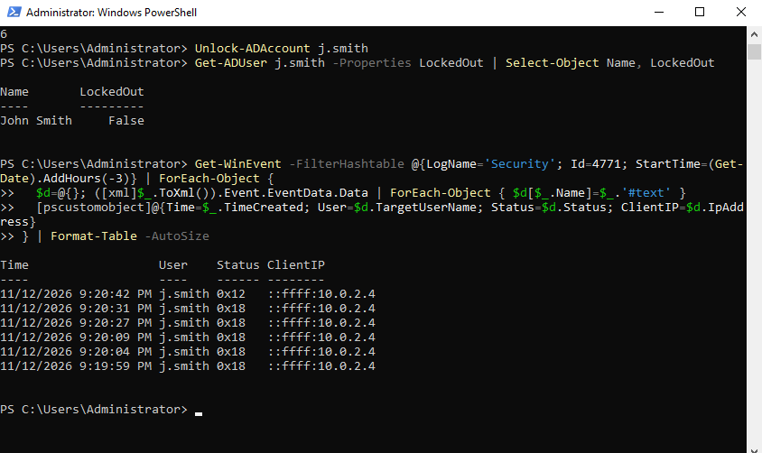

# 05 · Brute force and account lockout investigation

**Goal:** generate a run of failed logons against a domain account, trace them across the client and the domain controller, and decide whether it's a user mistake or an attack.

**Result:** five wrong passwords in 32 seconds locked `j.smith` out. I linked the client's failed-logon events, the domain controller's Kerberos failures and the lockout event to one machine (CLIENT01) and one account. MITRE ATT&CK: **T1110.001 Password Guessing**.

## Setup (DC01)
Lockout policy: 5 failed attempts within 15 minutes locks the account for 15 minutes.
```powershell
Set-ADDefaultDomainPasswordPolicy -Identity lab.local -LockoutThreshold 5 -LockoutDuration 00:15:00 -LockoutObservationWindow 00:15:00
```
Auditing, so the domain controller records failed Kerberos logons (4771) and lockouts (4740):
```powershell
auditpol /set /subcategory:"Kerberos Authentication Service" /success:enable /failure:enable
auditpol /set /subcategory:"User Account Management" /success:enable /failure:enable
```

## Simulation
On CLIENT01's sign-in screen, entered wrong passwords for `lab\j.smith` until Windows reported the account locked.

## Evidence

**CLIENT01: failed logons (Event ID 4625)**

| Time | User | Logon type | Status | Sub status |
| --- | --- | --- | --- | --- |
| 21:20:07 | lab\j.smith | 2 (interactive) | 0xC000006D | 0xC000006A (wrong password) |
| 21:20:10 | lab\j.smith | 2 | 0xC000006D | 0xC000006A |
| 21:20:13 | lab\j.smith | 2 | 0xC000006D | 0xC000006A |
| 21:20:24 | lab\j.smith | 2 | 0xC000006D | 0xC000006A |
| 21:20:27 | lab\j.smith | 2 | 0xC000006D | 0xC000006A |

**DC01: Kerberos pre-authentication failures (Event ID 4771)**

| Time | User | Status | Client IP |
| --- | --- | --- | --- |
| 21:19:59 | j.smith | 0x18 (wrong password) | 10.0.2.4 (CLIENT01) |
| 21:20:04 | j.smith | 0x18 | 10.0.2.4 |
| 21:20:09 | j.smith | 0x18 | 10.0.2.4 |
| 21:20:27 | j.smith | 0x18 | 10.0.2.4 |
| 21:20:31 | j.smith | 0x18 | 10.0.2.4 |
| 21:20:42 | j.smith | **0x12 (account locked)** | 10.0.2.4 |

**DC01: account locked out (Event ID 4740)** at 21:20:31. Account: `j.smith`. Caller Computer Name: `CLIENT01`.

The tables were built with [`scripts/parse-logon-failures.ps1`](scripts/parse-logon-failures.ps1), which pulls the fields out of each event's raw XML.

## Timeline
1. **21:19:59.** First wrong password reaches the domain controller.
2. **21:20:31.** Fifth wrong password. The threshold is reached and the account is locked (4740), 32 seconds after the first failure.
3. **21:20:42.** One more attempt is refused because the account is locked (4771, status 0x12).

## Correlation
- **Which machine?** The 4771 client IP (10.0.2.4) and the 4740 Caller Computer Name both point to CLIENT01.
- **Which account?** Only `j.smith`, every time.
- **How?** Logon type 2, so someone typed at CLIENT01's own keyboard, not a network or remote login.
- **Clocks:** the two machines' timestamps differ by a few seconds, so I matched events by order and count (five failures on each side) rather than exact time. Kerberos allows up to 5 minutes of clock difference.
- **Where each event lives:** 4625 is logged on the machine where the logon was attempted. 4771 and 4740 are logged on the domain controller only.

## Triage note
```
Alert:      Account lockout — lab\j.smith
Source:     CLIENT01 (10.0.2.4), interactive logon (type 2)
Pattern:    5 wrong passwords in 32 s, then 1 attempt against the locked account
Scope:      Single account, single machine — no other accounts targeted
Assessment: Most consistent with a user mistyping or forgetting their password
            (e.g. after a password change or with Caps Lock on). Not password
            spraying: that would show many accounts, one or two attempts each.
Next steps: 1. Check for a successful logon (4624) for j.smith after the failures —
               if a guess succeeded, treat as compromised.
            2. Contact the user to confirm it was them.
            3. Unlock only after the user is verified.
Escalate?:  Yes, if the user denies it, if a success follows the failures, if other
            accounts show failures from the same source, or if it happens out of hours.
Follow-up:  A successful logon (4624) for j.smith followed at 21:44:09, after the
            account was unlocked. Confirmed with the user as their own sign-in.
Verdict:    Controlled lab test — account unlocked (Unlock-ADAccount j.smith),
            success verified as legitimate. Closed.
```

The success check was run with:
```powershell
Get-WinEvent -FilterHashtable @{LogName='Security'; Id=4624; StartTime=(Get-Date).AddHours(-3)} | Where-Object { $_.Message -match 'j\.smith' } | Select-Object -First 3 TimeCreated
```

## What I learned
- One failed domain logon leaves evidence in two places: 4625 on the client and 4771 on the domain controller. Knowing which log holds which event saves time.
- Status codes carry the verdict. `0xC000006A` means a real account with the wrong password, while `0xC0000064` would mean a user name that doesn't exist, which points to someone guessing user names.
- The single most important follow-up after a run of failures is whether a success came next.

## Evidence






