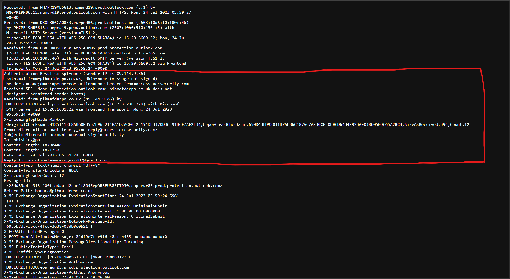
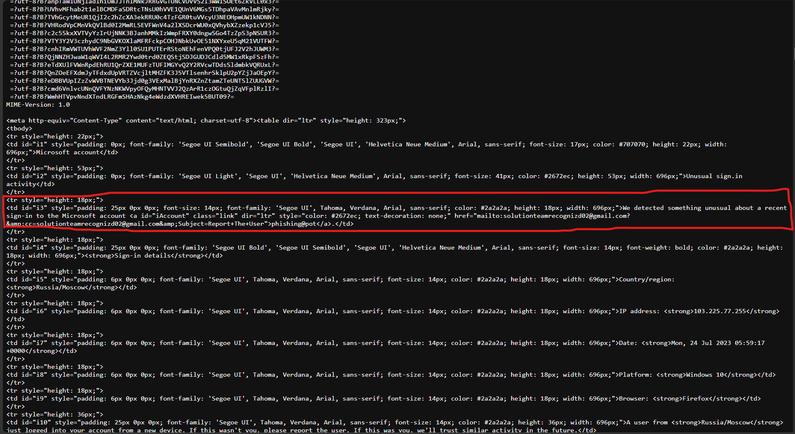

# 06 · Phishing analysis: fake Microsoft sign-in alert

**Goal:** analyse a real phishing email from its raw headers and body, decide what the attacker wants, and write the response a SOC would take.

**Result:** confirmed phishing that impersonates Microsoft. It fails every sender check, and replies go to an attacker-controlled Gmail address. It is reply-based phishing aimed at drawing the victim into a conversation, not a link to a fake login page. MITRE ATT&CK: **T1598 Phishing for Information** (within the wider **T1566 Phishing** family).

## Sample
`sample-12039.eml` from [phishing_pot](https://github.com/rf-peixoto/phishing_pot), a public collection of real phishing emails gathered for research (recipient address already anonymised as `phishing@pot`). Read as raw text in the browser, never opened in a mail client. All indicators below are defanged.

## Header analysis

| Check | Finding | Assessment |
| --- | --- | --- |
| Display name and subject | "Microsoft account team" · "Microsoft account unusual signin activity" | Brand impersonation plus urgency |
| From | `no-reply@access-accsecurity[.]com` | Not a Microsoft domain; made to look security-related |
| Reply-To | `solutionteamrecognizd02@gmail[.]com` | Replies go to a free Gmail account, not the sender. Strong phishing indicator |
| Return-Path | `bounce@pibmafderpo[.]co[.]uk` | A third, unrelated domain |
| SPF | `none`: `pibmafderpo[.]co[.]uk` publishes no SPF record | Sender can't be verified |
| DKIM | `none`: message not signed | No proof of origin or integrity |
| DMARC | `permerror`, `action=none` for `access-accsecurity[.]com` | The From domain's DMARC record is broken, so nothing told the receiver to reject it |
| Sending server | `pibmafderpo[.]co[.]uk` (89.144.9[.]86) into Microsoft 365 | Real Microsoft mail never comes from here |

Three different domains are involved (From, Reply-To, Return-Path), and none of them is Microsoft's.

## Body analysis

| Element | Finding |
| --- | --- |
| Fake sign-in details | "Country/region: Russia/Moscow", "IP address: 103.225.77[.]255", "Windows 10", "Firefox": invented to make the alert look specific and alarming |
| "Report the user" button | A `mailto:` link to the attacker's Gmail address, with the subject "unusual signin activity" and body "Report The User" already filled in |
| Tracking pixel | `hxxp://thebandalisty[.]com/track/…`, a hidden image that tells the attacker when the email is opened |
| Login link | None |

## What the attacker wants
The email has no fake login page, which is deliberate. The plan is:
1. Scare the victim with a fake "unusual sign-in" alert.
2. Get them to click "Report the user", which opens a pre-written email to the attacker's Gmail account.
3. Use the reply to confirm the address is live and that the person engages, then continue by email: asking for the password or a one-time code, or pushing a fake "support" call or remote-access tool.

Because there's no malicious link, URL scanners have nothing to catch. The attack only starts once the victim replies. The tracking pixel also tells the attacker which addresses opened the email, even without a reply.

## Triage note
```
Alert:      User-reported / filtered email — "Microsoft account unusual signin activity"
Verdict:    Malicious — Microsoft impersonation, reply-based phishing (T1598)
Evidence:   Non-Microsoft From domain; Gmail Reply-To; unrelated Return-Path;
            SPF none, DKIM none, DMARC permerror; mailto-only call to action
Risk:       Credential theft or MFA-code theft through email conversation;
            confirmation of live addresses for further targeting
Escalate?:  Yes — and treat as an incident for any user who replied
```

## Response a SOC would take
1. **Scope:** search all mailboxes for the sender, subject and Reply-To address to find every recipient.
2. **Contain:** remove the email from every mailbox. Block the From and Return-Path domains and the sending IP. Block **outbound** mail to the attacker's Gmail address, so nobody can reply from now on.
3. **Check for replies:** search sent items for anything sent to that Gmail address. For any user who replied, contact them, reset their password, revoke active sessions, re-check MFA and review recent sign-ins.
4. **Block tracking:** block `thebandalisty[.]com` at the web proxy or DNS filter.
5. **Tell users:** a short warning with a screenshot of the email, plus how to report suspicious emails.
6. **Report:** forward to the NCSC's Suspicious Email Reporting Service (report@phishing.gov.uk) and to Microsoft.

## Indicators of compromise

| Type | Value |
| --- | --- |
| Sender address | `no-reply@access-accsecurity[.]com` |
| Reply-To | `solutionteamrecognizd02@gmail[.]com` |
| Return-Path domain | `pibmafderpo[.]co[.]uk` |
| Sending IP | `89.144.9[.]86` |
| Tracking domain | `thebandalisty[.]com` |

## What I learned
- No malicious link doesn't mean safe. A `mailto:` call to action pointing at a free webmail account is itself a red flag.
- When From, Reply-To and Return-Path all differ, ask where a reply would actually go.
- DMARC `permerror` isn't a pass. A broken policy gives no protection.
- The most important response step is checking who replied. That is where a phishing email becomes a compromised account.

## Evidence



