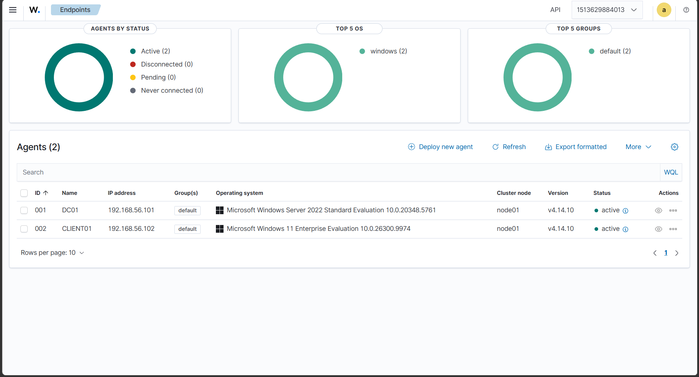
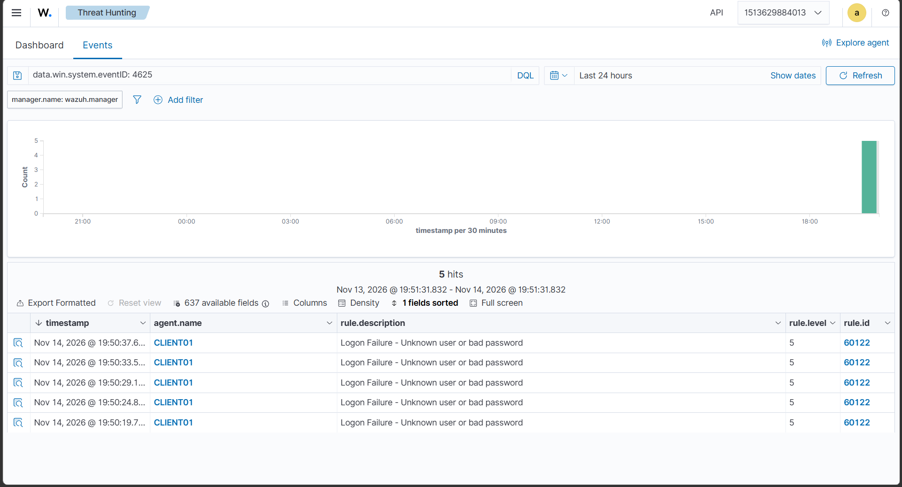
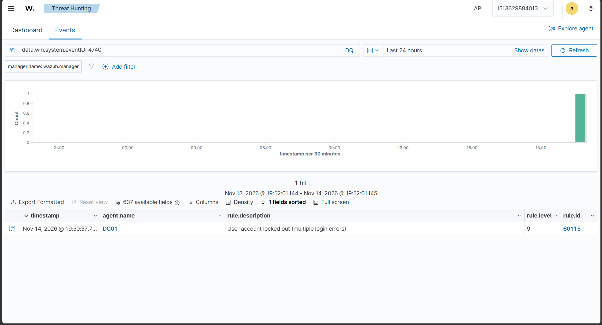
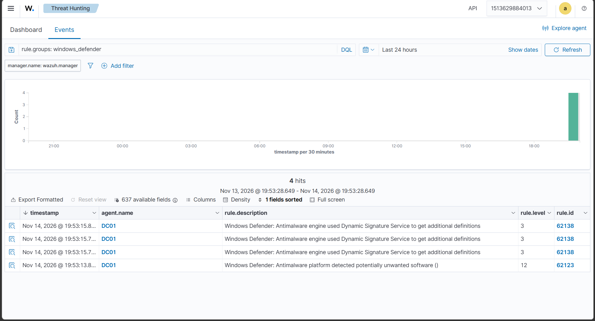
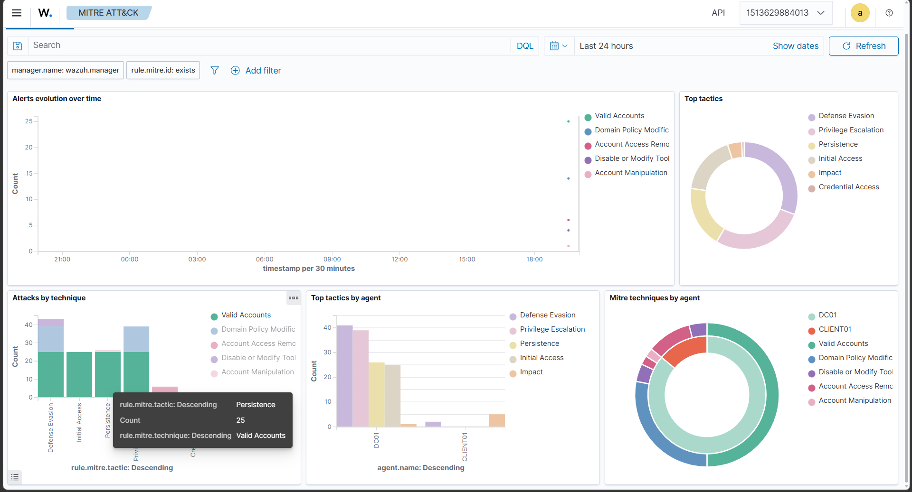

# 07 · SIEM detection with Wazuh

**Goal:** stand up a SIEM, connect the lab's machines to it, then re-run earlier attacks and investigate them from one console instead of logging into each machine.

**Result:** Wazuh 4.14.10 running in Docker, with agents on DC01 and CLIENT01. The brute-force attack and the malware test both raised alerts, mapped to MITRE ATT&CK. Reading the rules behind them also showed a detection gap: the account locked out before Wazuh's brute-force correlation rule could fire.

## Setup

| Component | Detail |
| --- | --- |
| SIEM | Wazuh 4.14.10 single-node (manager, indexer, dashboard) in Docker Desktop on the host laptop |
| Agents | DC01 (agent 001) and CLIENT01 (agent 002), Wazuh agent 4.14.10 |
| Agent traffic | VMs → host 192.168.56.1, TCP 1514 (events) and 1515 (enrolment) |
| Log sources | Windows Security, System, Application by default, plus **Defender Operational** added centrally |

**Hardening decisions**
- **Kept the SIEM off the home network.** The default setup publishes the dashboard (443), indexer (9200) and API (55000) on every network interface, with default credentials. I rebound all three to `127.0.0.1` in `docker-compose.yml`, leaving only the agent ports (1514/1515) reachable.
- **Restricted the host firewall rule to the lab network:**
  ```powershell
  New-NetFirewallRule -DisplayName "Wazuh agents (lab only)" -Direction Inbound -Protocol TCP -LocalPort 1514,1515 -RemoteAddress 192.168.56.0/24 -Action Allow
  ```

**Central configuration.** Defender's log isn't collected by default. Instead of editing each machine, I added it once to the `default` agent group's `agent.conf`, which every agent in the group picks up automatically:
```xml
<agent_config os="Windows">
  <localfile>
    <location>Microsoft-Windows-Windows Defender/Operational</location>
    <log_format>eventchannel</log_format>
  </localfile>
</agent_config>
```

## Detection 1: brute force against a domain account

Five wrong passwords for `lab\j.smith` at CLIENT01's sign-in screen, 19:50:19–19:50:37.

| Time | Agent | Rule | Level | Description | MITRE |
| --- | --- | --- | --- | --- | --- |
| 19:50:19 → 19:50:37 (×5) | CLIENT01 | 60122 | 5 | Logon Failure - Unknown user or bad password | T1531 |
| 19:50:37 | DC01 | **60115** | **9** | User account locked out (multiple login errors) | **T1110 Brute Force**, T1531 |

**What the rules showed.** Wazuh has a correlation rule for this attack, **60204 "Multiple Windows Logon Failures"** (level 10, T1110). It needs **8** failures from the same source IP within 240 seconds. This domain locks accounts after **5**, so the attack was stopped before the correlation rule could trigger. Here, the lockout alert (60115) is the brute-force signal.

This matters in two ways:
- **Tuning:** an analyst who only watches for 60204 would miss this attack. Alerting on 60115, or lowering 60204's threshold to match the lockout policy, closes the gap.
- **Password spraying:** 60204 groups failures by **source IP, not by account**, so it's the rule that would catch one machine trying one or two passwords against many accounts, which never triggers a lockout.

## Detection 2: malware (EICAR test file)

| Time | Agent | Rule | Level | Description |
| --- | --- | --- | --- | --- |
| 19:53:13 | DC01 | **62123** | **12** | Windows Defender: Antimalware platform detected potentially unwanted software (Event 1116) |
| 19:53:15 (×3) | DC01 | 62138 | 3 | Windows Defender: Antimalware engine used Dynamic Signature Service to get additional definitions (Event 2010) |

The detection is a **level 12** alert, the highest in this lab. Straight afterwards, Defender queried Microsoft's cloud service for more signatures (rule 62138), which is part of how it confirms a detection.

## MITRE ATT&CK view
The MITRE dashboard maps every alert to tactics and techniques. Alongside this lab's tests (Credential Access from T1110, Impact from T1531), it showed a large amount of normal domain-controller activity mapped to techniques such as **Valid Accounts** (successful logons) and **Domain Policy Modification**. Most mapped alerts aren't attacks. The analyst's job is to separate the 2 or 3 that matter from the background.

## What I learned
- A SIEM puts both sides of an attack on one screen: the failures on the client and the lockout on the domain controller, which took two machines and several PowerShell commands in lab 05.
- **Read the rule, not just the alert.** The brute-force rule's threshold (8) is higher than the lockout policy (5), so the "obvious" detection never fired. Knowing why is detection engineering, not just alert-watching.
- Collect logs centrally. One change to the agent group added Defender monitoring to every machine.
- Rule levels drive priority. Level 12 (malware) and level 9 (lockout) stand out from level 3–5 noise.

## Evidence






