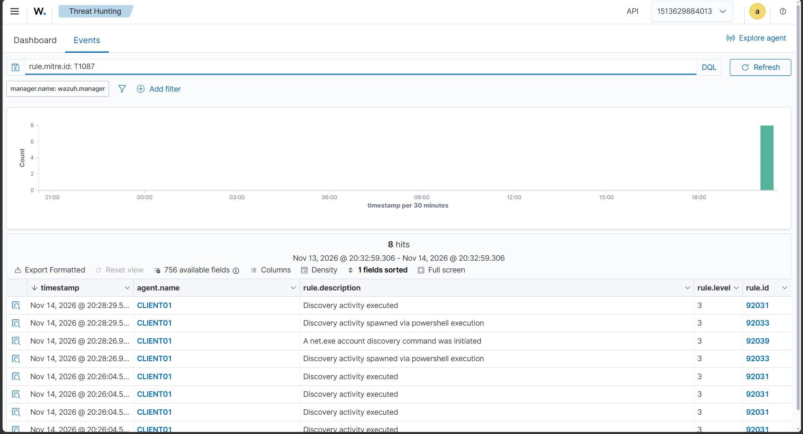
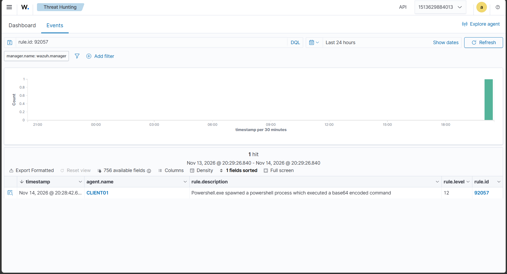
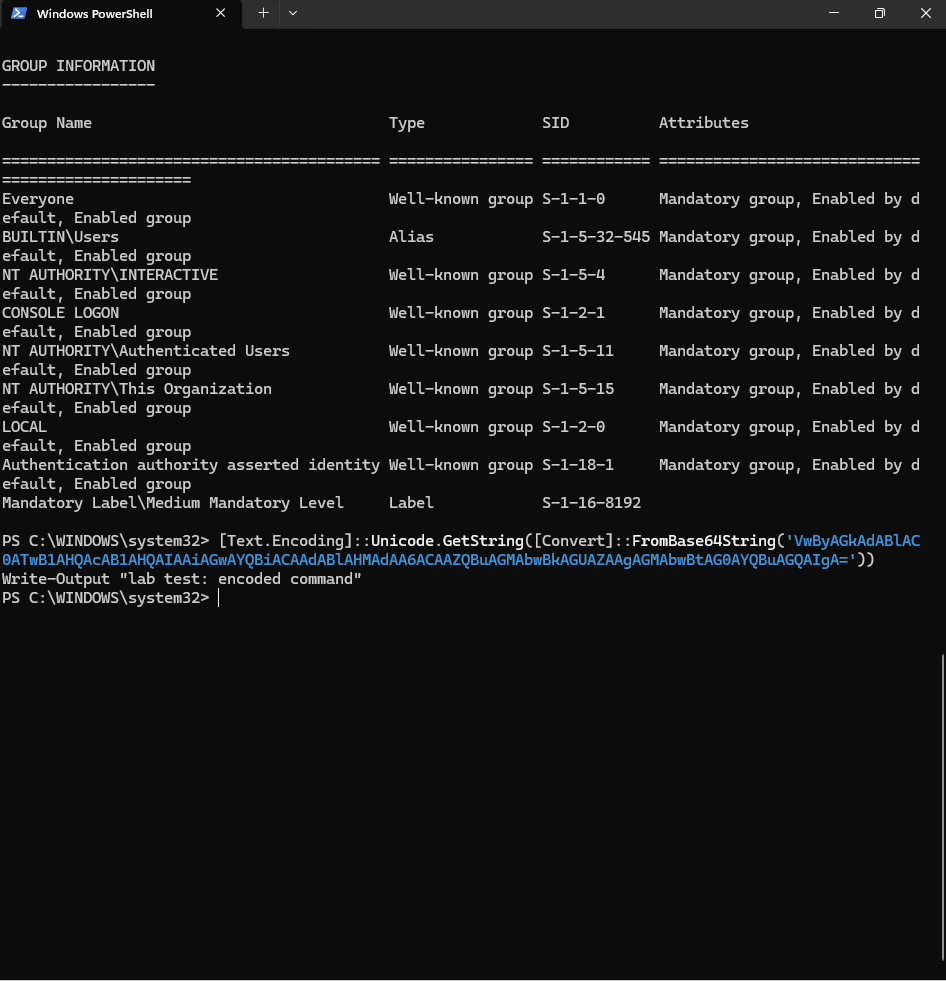
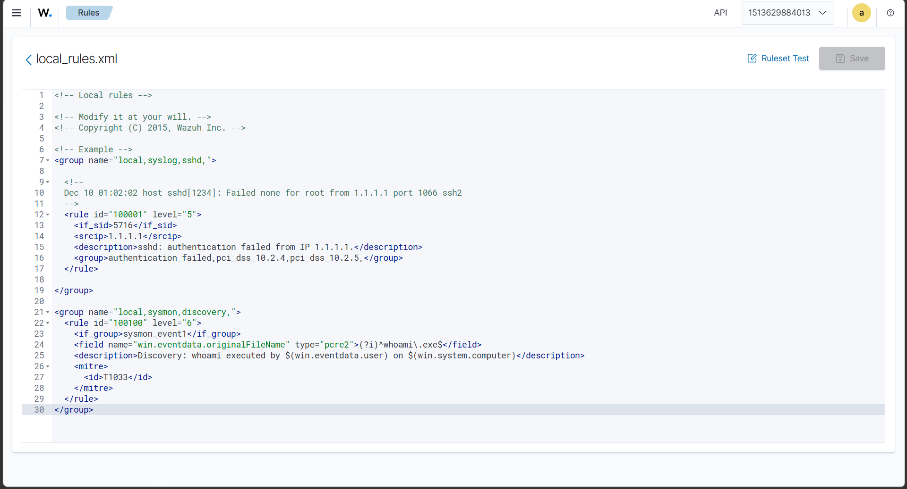
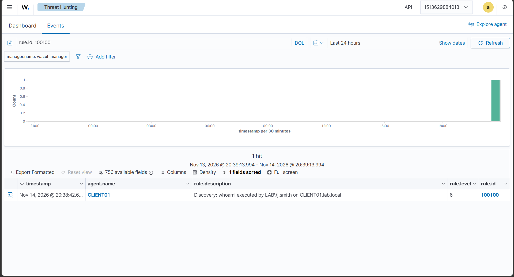

# 08 · Sysmon process logging and a custom detection rule

**Goal:** see what programs run on an endpoint and with what commands, catch an attacker working from a compromised account, and write a detection for something the SIEM missed.

**Result:** Sysmon on CLIENT01, feeding Wazuh. A simulated attacker using `j.smith`'s account ran domain discovery commands and a base64-encoded PowerShell command. Wazuh flagged both, the encoded command at **level 12 (MITRE T1059.001)**. One discovery command, `whoami`, produced no alert, so I wrote a **custom Wazuh rule (100100)** that now detects it.

## Setup
- **Sysmon** (Microsoft Sysinternals) installed on CLIENT01 with the **SwiftOnSecurity** baseline configuration, which filters routine Windows noise: [`scripts/install-sysmon.ps1`](scripts/install-sysmon.ps1).
- **Wazuh collection:** added the Sysmon log to the `default` agent group's `agent.conf`, next to the Defender log from lab 07:
  ```xml
  <localfile>
    <location>Microsoft-Windows-Sysmon/Operational</location>
    <log_format>eventchannel</log_format>
  </localfile>
  ```
- **How Wazuh treats Sysmon by default:** ordinary process-creation events (Sysmon Event 1) are stored at **level 0**, so they never appear as alerts. Alerts only fire when a command matches a suspicious-behaviour rule.

## Scenario
An attacker has guessed `j.smith`'s password (lab 05) and signs in to CLIENT01. In a normal, non-admin PowerShell window they:
1. Find out who they are: `whoami /groups`
2. List domain users: `net user /domain`
3. Find the administrators: `net group "Domain Admins" /domain`
4. Run a hidden command: `powershell.exe -EncodedCommand <base64>`

## Detections

| Time | Rule | Level | Description | MITRE |
| --- | --- | --- | --- | --- |
| 20:28:26.9 | 92033, 92039 | 3 | Discovery activity spawned via PowerShell · net.exe account discovery command | T1087 |
| 20:28:29.5 | 92033, 92031 | 3 | Discovery activity spawned via PowerShell · Discovery activity executed | T1087 |
| 20:28:42.6 | **92057** | **12** | Powershell.exe spawned a powershell process which executed a base64 encoded command | **T1059.001** (Execution) |
| — | none | — | `whoami /groups` recorded by Sysmon, **no alert** | — |

Each `net` command raised two alerts because `net.exe` starts a helper program, `net1.exe`, to do the work, and Sysmon logs both. An earlier run of the commands at 20:26 produced four more 92031 alerts.

## Investigating the encoded PowerShell alert
A trimmed copy of the alert is in [`evidence/92057-alert.json`](evidence/92057-alert.json).

| Field | Value | What it tells me |
| --- | --- | --- |
| User | `LAB\j.smith` | The compromised account |
| Integrity level | Medium | The attacker didn't have admin rights |
| Parent → child | `powershell.exe` (PID 4060) → `powershell.exe -EncodedCommand …` (PID 8160) | PowerShell launching hidden PowerShell |
| Logon ID | `0x84246C` | The **same session** as the discovery commands 15 seconds earlier |
| Command line | `-EncodedCommand VwByAGkAdABlAC0ATwB1AHQAcAB1AHQA…` | Base64, so it can't be read at a glance |

**Decoding it:**
```powershell
[Text.Encoding]::Unicode.GetString([Convert]::FromBase64String('VwByAGkAdABlAC0ATwB1AHQAcAB1AHQAIAAiAGwAYQBiACAAdABlAHMAdAA6ACAAZQBuAGMAbwBkAGUAZAAgAGMAbwBtAG0AYQBuAGQAIgA='))
```
Result: `Write-Output "lab test: encoded command"`. It was harmless here. In a real incident, this decoded text is what tells you whether to escalate.

**Timeline:** discovery at 20:28:26 and 20:28:29, then the hidden command at 20:28:42, all from logon session `0x84246C`. That's one attacker session running discovery and then execution, which is a pattern worth escalating.

## Closing a detection gap: custom rule 100100
I checked Wazuh's built-in Sysmon rules: none covers `whoami`, one of the first commands an attacker runs. Sysmon recorded it, but the SIEM never surfaced it. I wrote a rule for it: [`rules/local_rules-100100.xml`](rules/local_rules-100100.xml).

```xml
<rule id="100100" level="6">
  <if_group>sysmon_event1</if_group>
  <field name="win.eventdata.originalFileName" type="pcre2">(?i)^whoami\.exe$</field>
  <description>Discovery: whoami executed by $(win.eventdata.user) on $(win.system.computer)</description>
  <mitre>
    <id>T1033</id>
  </mitre>
</rule>
```

**Design choices**
- **It matches `originalFileName`, not the file path.** That value is built into the program itself, so the rule still fires if an attacker renames or copies `whoami.exe` to dodge detection.
- **Rule ID 100100** sits in the range reserved for custom rules, so it never clashes with Wazuh's own.
- **Level 6:** above routine noise, below the level-12 high-confidence detections. Admins run `whoami` too, so this alert is context to weigh, not proof of an attack on its own.

**Tested:** I re-ran `whoami /groups` as `j.smith`, and rule 100100 fired at 20:38:42 with "Discovery: whoami executed by LAB\\j.smith on CLIENT01.lab.local" (level 6, T1033).

## What I learned
- Default logs show who logged in. Sysmon shows **what they did**: every process, its parent, its command line and its user.
- A SIEM's silence isn't safety. Sysmon recorded `whoami`, but no rule surfaced it until I wrote one.
- Linking events by **logon ID** turns separate alerts into one attacker's timeline.
- Encoded commands are a red flag in themselves. Decoding them is a standard first step.

## Evidence






