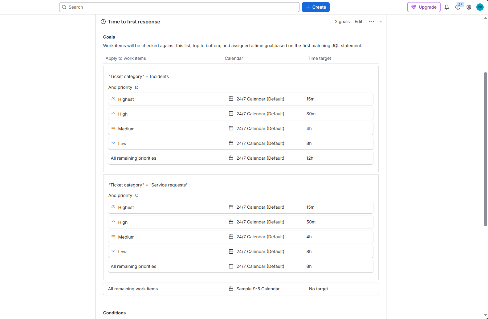
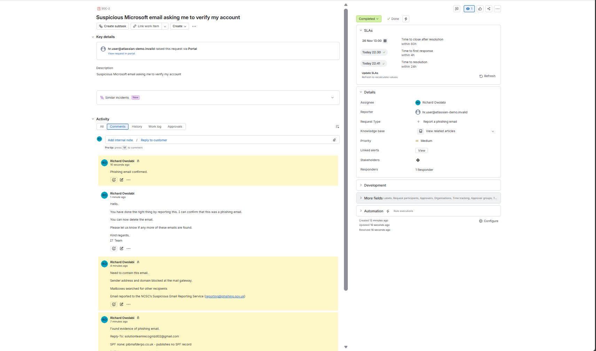
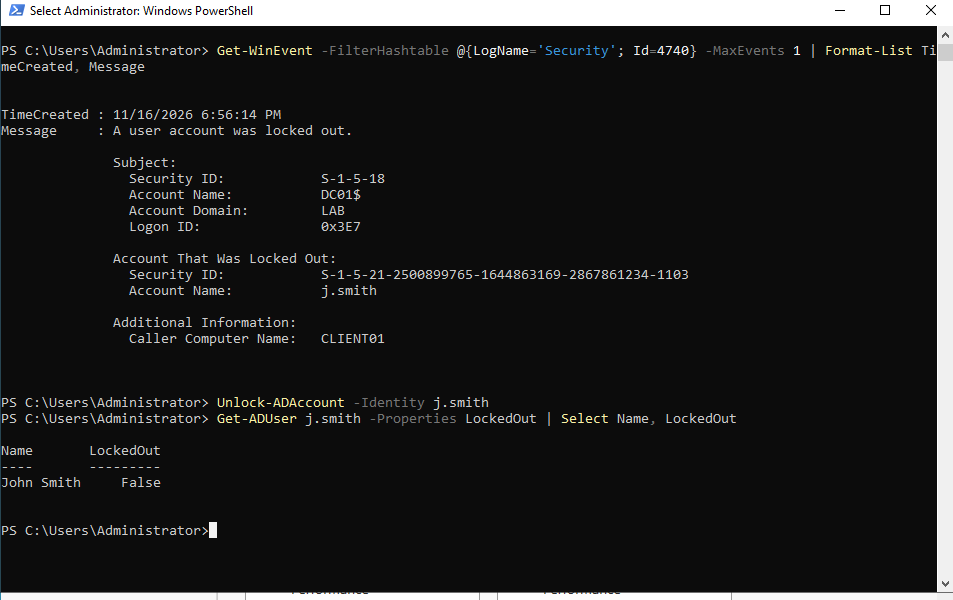
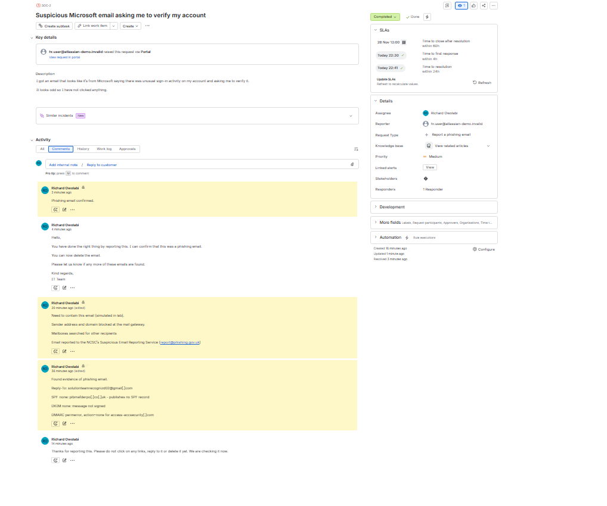
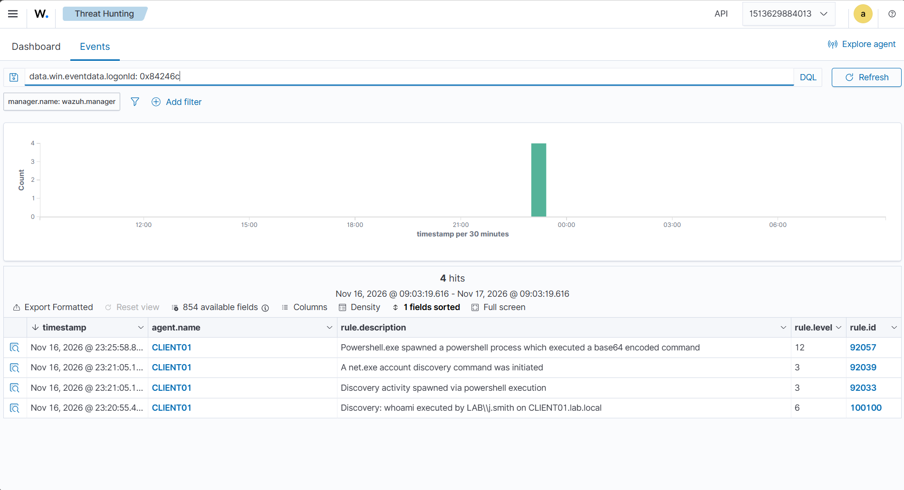
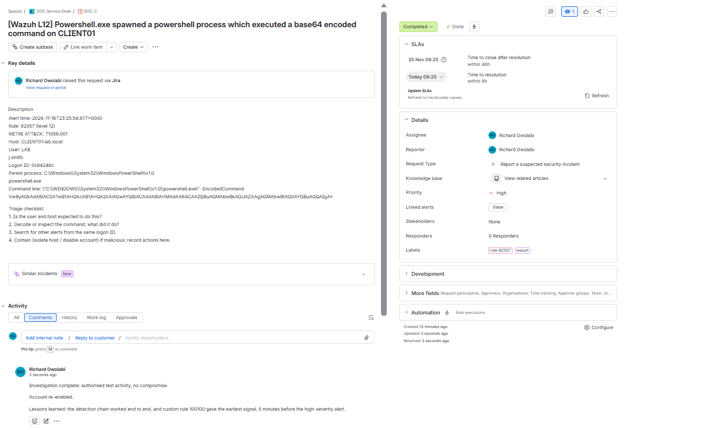
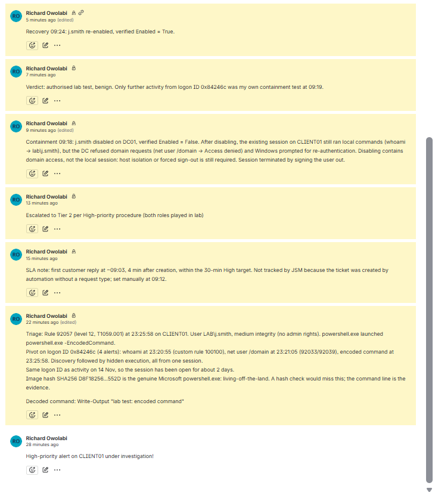
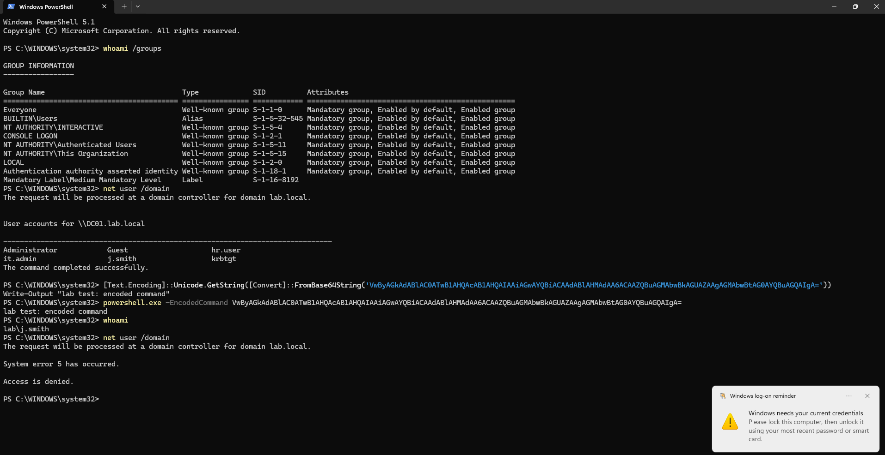
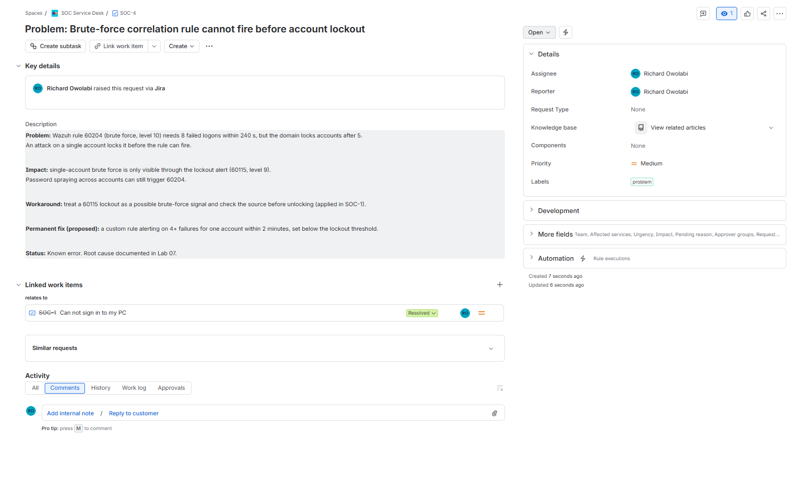
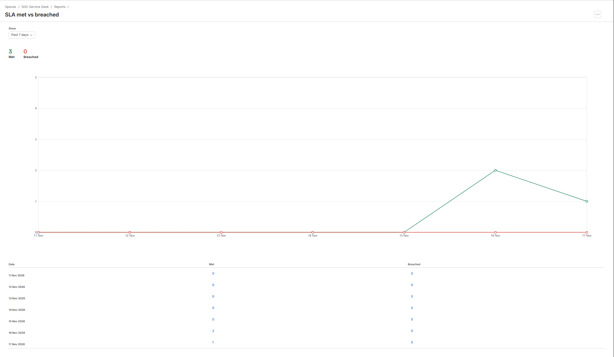

# 09 · Ticketing, SLAs and alert-to-ticket automation

**Goal:** run security work the way a service desk or SOC does: every request and alert becomes a ticket with a priority, a timed target (SLA), a written record of what was done and when, and a clean close.

**Result:** a Jira Service Management desk with request types, a priority matrix and 24/7 SLAs. Four tickets worked end to end: an account lockout, a phishing report, a high-severity Wazuh alert turned into a ticket by my own Python script, and an ITIL problem record. **All three timed tickets met their resolution SLA (3 met, 0 breached).** Building the automation also exposed three gaps in how automated tickets bypass desk controls.

## Setup
- **Jira Service Management (Free plan)**, IT service management template, space `SOC Service Desk` (key `SOC`).
- **Work types available:** `[System] Incident`, `[System] Service request`, `[System] Service request with approvals`, `Task`, `Sub-task`. The free plan has **no Problem work type**, so problem records are Tasks labelled `problem`.
- **Request types** (what a user picks on the portal), written in plain English for non-technical users:

| Request type | Work type | Portal description |
| --- | --- | --- |
| Report a suspected security incident | Incident | Something on your device or account doesn't look right. |
| Report a phishing email | Incident | Forward details of a suspicious email. Don't click links or open attachments. |
| Account locked / password reset | Service request | Can't sign in to your computer or account. |

### Priority matrix
| Priority | When |
| --- | --- |
| Highest (P1) | Confirmed compromise, or several hosts affected |
| High (P2) | Likely compromise of one user or host (e.g. Wazuh alert level 12+) |
| Medium (P3) | Suspicious activity needing triage, or a user who can't work |
| Low (P4) | Information or routine requests |

### SLA goals
Goals are matched by ticket category (Incidents or Service requests), then by priority, on a **24/7 calendar**: a SOC doesn't stop at 5pm, and the template's default 9–5 calendar would let a P1 raised at 7pm wait until morning.

| Priority | Time to first response | Time to resolution |
| --- | --- | --- |
| Highest | 15 min | 4 h |
| High | 30 min | 8 h |
| Medium | 4 h | 24 h |
| Low | 8 h | 72 h |

- **Time to resolution pauses** while a ticket is *Waiting for customer* (default condition), so the desk isn't penalised for a user who doesn't reply.
- **All remaining work items: no target.** Tasks, including problem records, get no SLA. That's deliberate: problem management is root-cause work, not a time-boxed request.

## The tickets

### SOC-1 · Account lockout (service request, Medium): first-line support
A user reports they can't sign in. I locked `j.smith` for real with 5 wrong passwords on CLIENT01, then raised the request through the portal as that user.

**I checked why the account locked before unlocking it**, because a lockout can be a brute-force attack (lab 05):
```text
PS> Get-ADUser j.smith -Properties LockedOut, BadLogonCount, LastBadPasswordAttempt | Select Name, LockedOut, BadLogonCount, LastBadPasswordAttempt
Name       LockedOut BadLogonCount LastBadPasswordAttempt
John Smith      True             5 11/16/2026 6:56:14 PM

PS> Get-WinEvent -FilterHashtable @{LogName='Security'; Id=4740} -MaxEvents 1 | Format-List TimeCreated, Message
TimeCreated : 11/16/2026 6:56:14 PM
Message     : A user account was locked out.
              Account That Was Locked Out:   Account Name: j.smith
              Additional Information:        Caller Computer Name: CLIENT01
```
The last bad password and the lockout event match to the second, and the caller is the user's own PC: consistent with the user mistyping, as they confirmed. Wazuh raised the lockout alert (rule 60115).

- **Identity verified before unlocking** (callback to the number on record, simulated). Help-desk impersonation is a real attack route: attackers posing as an employee on the phone to the help desk were behind the 2023 MGM Resorts breach.
- Unlocked with `Unlock-ADAccount`, verified `LockedOut = False`, user signed in, ticket resolved.
- **SLA:** first response met (19:00), resolution met (19:15).

### SOC-2 · Phishing report (incident, Medium)
Raised through the portal by `hr.user`, using the Microsoft-impersonation email from [lab 06](../06-phishing-analysis/).
- **First reply** told the user not to click, reply or delete yet.
- **Findings (internal note, IOCs defanged):** Reply-To `solutionteamrecognizd02@gmail[.]com`; SPF none (`pibmafderpo[.]co[.]uk` publishes no SPF record); DKIM none (message not signed); DMARC permerror, action none, for `access-accsecurity[.]com`.
- **Containment (simulated in lab):** sender address and domain blocked at the mail gateway; mailboxes searched for other recipients; reported to the NCSC Suspicious Email Reporting Service (`report@phishing.gov.uk`).
- **Closing reply** in plain English: it was phishing, they did the right thing, they can now delete it.
- **SLA:** first response met (22:30), resolution met (22:41).

### SOC-3 · Encoded PowerShell (incident, High): alert to ticket by automation
**Attack simulated as `j.smith` on CLIENT01:** `whoami /groups`, `net user /domain`, then `powershell.exe -EncodedCommand …`. Wazuh raised rule 92057 (level 12, T1059.001). I exported the alert JSON ([`evidence/alert-92057.json`](evidence/alert-92057.json)) and created the ticket with my script, [`scripts/wazuh_alert_to_jira.py`](scripts/wazuh_alert_to_jira.py):
```text
> python 09-ticketing-sla\scripts\wazuh_alert_to_jira.py 09-ticketing-sla\evidence\alert-92057.json --send
Created: SOC-3
```
The script maps the Wazuh level to a priority (12+ → High), fills in host, user, logon ID, parent process and command line, and adds a triage checklist. Credentials come from environment variables, never from the file. It does a dry run unless told `--send`.

**Triage: pivot on the logon ID.** Searching Wazuh for `data.win.eventdata.logonId: 0x84246c` returned the whole chain from one session:

| Time (16 Nov) | Rule | Activity |
| --- | --- | --- |
| 23:20:55 | **100100** (my custom rule, lab 08) | `whoami`: first sign of discovery |
| 23:21:05 | 92033 / 92039 | `net user /domain`: account discovery |
| 23:25:58 | **92057** (level 12) | Hidden encoded PowerShell |

- **My custom rule gave the earliest signal, five minutes before the high-severity alert.**
- **Living off the land:** the process hash (SHA-256 `D8F18256…552D`) is the genuine, Microsoft-signed `powershell.exe`. A hash check finds nothing wrong; the command line is the evidence.
- The logon ID was the same as the lab 08 activity on 14 Nov: the session had been open for two days.
- **Decoded command:** `Write-Output "lab test: encoded command"`.

**Escalation and containment.** Escalated per the High-priority procedure (I played Tier 1 and Tier 2). At 09:18 I disabled `j.smith` on DC01 and verified `Enabled = False`. **Then I tested whether that was enough:**
- `whoami` on CLIENT01 still worked: **the local session survived.**
- `net user /domain` returned **Access is denied**, and Windows prompted for re-authentication: **the domain controller refused new domain requests.**

Disabling the account contained domain access but not the local session, so host isolation or forced sign-out is still needed. I signed the user out. Verdict: authorised test, benign; the only later activity in that session was my own containment test. Account re-enabled 09:24, verified, ticket resolved.
- **SLA:** resolution met (09:25, target 16:58). First response sent about 4 minutes after creation, but **not tracked**; see the automation gaps below.

### SOC-4 · Problem record: why the brute-force rule can't fire
A Task labelled `problem`, linked to SOC-1, left **open as a known error**:
- **Problem:** Wazuh rule 60204 (brute force, level 10) needs 8 failed logons within 240 s, but the domain locks accounts after 5. An attack on a single account locks it before the rule can fire ([lab 07](../07-siem-wazuh/)).
- **Impact:** single-account brute force is only visible through the lockout alert (60115, level 9). Password spraying across accounts can still trigger 60204.
- **Workaround:** treat a 60115 lockout as a possible brute-force signal and check the source before unlocking (as in SOC-1).
- **Permanent fix (proposed):** a custom rule alerting on 4+ failures for one account within 2 minutes, set below the lockout threshold.

This is the ITIL distinction between **incident management** (restore service: unlock the account) and **problem management** (fix the cause, so the next attack is caught).

## What the automation got wrong, and what I learned from it
1. **A misleading error.** The first `--send` returned `400: The target project doesn't exist or you don't have permission`. The project did exist. I changed the script to print Jira's error body, then tested the login on its own against the `/rest/api/2/myself` endpoint, which returned *"Client must be authenticated"*. The cause was a stray `<` in the email variable. Jira Cloud treats a failed login as an anonymous user, and anonymous users can't see the project.
2. **Automated tickets skipped desk controls.** Created through the API, SOC-3 had **no request type and no reporter** ("Anonymous"). With no request type it matched no SLA goal, so **the 30-minute first-response target never started.** I set both by hand (09:12). Fix: create tickets through the Service Management request API with a request type, from a named service account such as "Wazuh integration", so every automated ticket is accountable and timed.
3. **Formatting.** Jira's markup treats `\\` as a line break, so Windows paths were broken across lines. The script now cleans Wazuh's doubled backslashes and puts process details in a `{noformat}` block.
4. **Alert-to-ticket delay.** The alert fired at 23:25 but was ticketed at 08:59 the next morning because I ran the script by hand. In production, Wazuh's integration feature would call it on every alert above a set level, so tickets appear within seconds.

The API token was created with a one-week expiry, held only in a PowerShell session variable, and revoked after the lab.

## Results
| Ticket | Type | Priority | First response | Resolution |
| --- | --- | --- | --- | --- |
| SOC-1 | Service request | Medium | Met | Met |
| SOC-2 | Incident | Medium | Met | Met |
| SOC-3 | Incident | High | ~4 min, not tracked (automation gap) | Met |
| SOC-4 | Problem (Task) | Medium | No SLA by design | Open: known error |

The SLA met vs breached report shows **3 met, 0 breached** over the week (SOC-1 and SOC-2 on 16 Nov, SOC-3 on 17 Nov).

## Evidence










