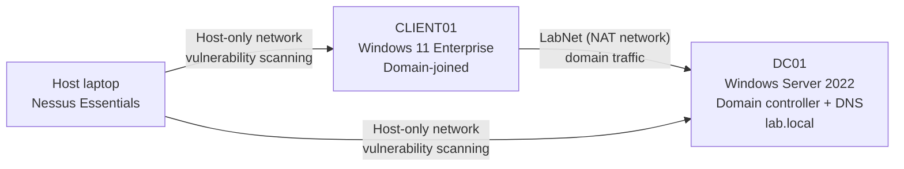

# SOC Home Lab

A hands-on security operations lab built and documented by **Richard Owolabi**: Active Directory, vulnerability management, endpoint detection, log investigation and phishing analysis, each written up the way a SOC analyst would record it.

CompTIA Security+ · ISC2 Certified in Cybersecurity · CompTIA CySA+ in progress

## Lab environment

| Machine | Role | Lab network | Scanning network |
| --- | --- | --- | --- |
| DC01 | Windows Server 2022 domain controller and DNS for `lab.local` | 10.0.2.10 (static) | 192.168.56.101 |
| CLIENT01 | Windows 11 Enterprise, domain-joined | DHCP | 192.168.56.102 |
| Host | Nessus Essentials scanner | — | Host-only adapter |

Built in VirtualBox 7 on a Windows 11 laptop (Ryzen 5, 24 GB RAM).

## Labs

| # | Lab | Skills | Key result |
| --- | --- | --- | --- |
| 01 | [Lab build](01-lab-build/) | Active Directory, DNS, PowerShell | Domain, OUs, users and groups scripted; client joined |
| 02 | [Vulnerability management](02-vulnerability-management/) | Nessus, CVSS, patching, verification | 24 critical and 47 high reduced to 0 critical and 0 high |
| 03 | [Malware detection (EICAR)](03-malware-detection-eicar/) | Microsoft Defender, event logs, triage | Detected and quarantined in 48 seconds; PowerShell origin flagged |
| 04 | [Email header analysis](04-email-header-analysis/) | SPF, DKIM, DMARC, link analysis | Legitimate verdict; weak DMARC policy identified |
| 05 | [Brute force and lockout](05-brute-force-lockout/) | Windows event logs, Kerberos, PowerShell, MITRE T1110 | 5 failures in 32 s traced across client and DC to one machine and account |
| 06 | [Phishing analysis](06-phishing-analysis/) | Header and body analysis, IOCs, MITRE T1598 | Microsoft impersonation confirmed; reply-based attack and response plan documented |

## Roadmap

- Wazuh SIEM with agents on both hosts
- Sysmon process logging (MITRE T1059.001)
- Packet capture analysis in Wireshark
- Ticketing workflow with SLAs

## Notes

Everything here runs in an isolated lab with test accounts and no real personal data. Screenshots are cropped to the lab windows, and passwords and licence codes are never shown.
